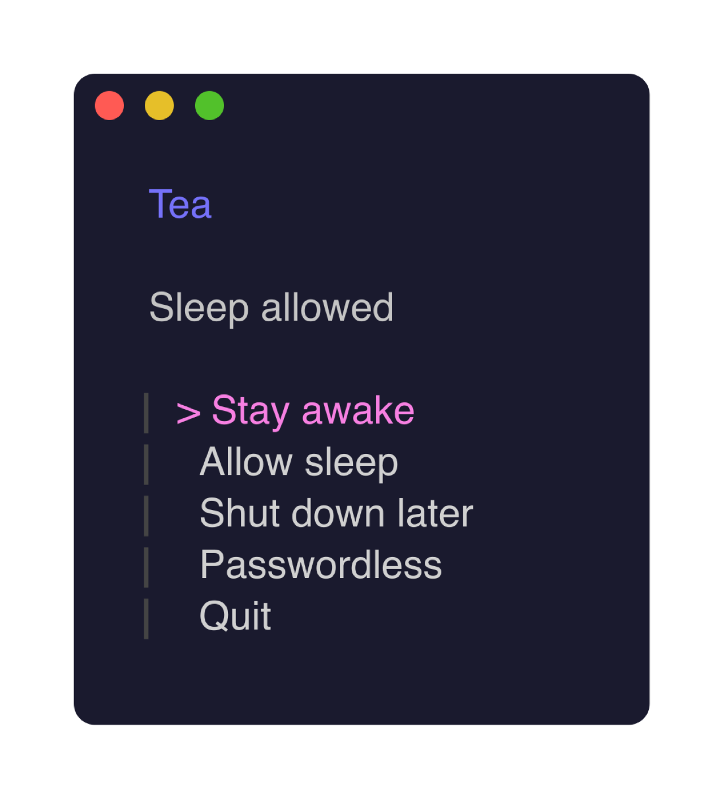

# tea

<p align="center">
  <a href="https://github.com/soundadam/tea/actions/workflows/ci.yml"></a>
  <a href="https://github.com/soundadam/tea/releases/latest"></a>
  <a href="LICENSE"></a>
</p>

<p align="center"><strong>Keep a Mac awake. Restore it when you're done.</strong></p>

<p align="center">
  
</p>

```sh
brew install --cask soundadam/tap/tea
tea
```

That's the client. It stays open. Keep the Mac awake — including with the lid
closed — then restore the exact sleep setting it owned.

<p align="center">
  
</p>

Need a script instead?

```sh
tea on
tea shutdown after 2h
tea off
```

## Why not `caffeinate`

`caffeinate` keeps a Mac awake only while its own process runs: close the
terminal or lose the SSH session and the Mac can sleep, and closing a
MacBook's lid still sleeps it. tea sets the system `disablesleep` value
instead, so the Mac stays up with the lid closed, on battery or AC, with
nothing left running. It records the previous value first, and `tea off`
restores that value and nothing else. It can also schedule one delayed
shutdown and cancel exactly that one.

The name: **tea**, as opposed to caffeinate's caffeine. It was called teaway
up to 0.4.2. homebrew-core's `tea` is the unrelated Gitea CLI, so always install
with the full name `soundadam/tap/tea`.

macOS 13+. Don't close a MacBook in a bag.

## Install and update

- Homebrew: `brew install --cask soundadam/tap/tea`.
- Direct download: `tea-<version>-macos-aarch64.tar.gz` (Apple silicon) or
  `-macos-x86_64.tar.gz` (Intel) from
  [Releases](https://github.com/soundadam/tea/releases); put `tea` on your `PATH`.

The executable is ad-hoc signed and not notarized. The Homebrew install opens
without a prompt. A downloaded copy is blocked the first time it runs: allow it
under System Settings → Privacy & Security, or run
`xattr -dr com.apple.quarantine <the unpacked tea>`.

`tea update` installs the latest release (`tea update --check` only reports
it): a Homebrew install upgrades through `brew`, a downloaded `tea` replaces
itself. The client shows a line when a newer release exists and updates on `u`.
`tea update --auto off` stops the daily check (`on` turns it back on).
How the install is detected and which requests are made:
[appkit](https://github.com/soundadam/appkit#更新).

After an update, `tea auth register` refreshes the passwordless helper; until
then, privileged actions go through `sudo`.

[Product](https://soundadam.com/projects/tea/) · [Docs](https://teaway.mintlify.app) · [Changelog](CHANGELOG.md) · [Contributing](CONTRIBUTING.md) · [Security](SECURITY.md)
